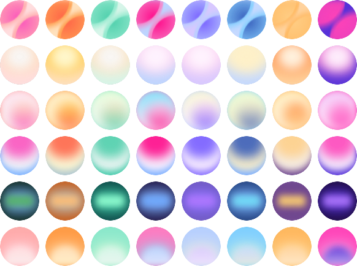

# @superslate/avatar

[](https://www.npmjs.com/package/@superslate/avatar)
[](https://github.com/superslate-dev/avatar/actions/workflows/ci.yml)
[](./LICENSE)

Zero-dependency soft gradient SVG avatar generator by [Superslate](https://superslate.dev/?ref=avatar-readme).

**[Try the live studio →](https://superslate.dev/avatars/)**

<picture>
  <source media="(prefers-color-scheme: dark)" srcset="https://raw.githubusercontent.com/superslate-dev/avatar/main/assets/preview-dark.svg">
  
</picture>

Renders crisp 64×64 circular gradient avatars from a deterministic design grammar:

- 6 shape families: Prism, Veil, Ember, Zenith, Beam, Horizon
- 40 curated palette presets
- OKLCH tone controls for global hue, relative chroma, and lightness shifts
- Dedicated light and dark appearances with OKLCH palette derivation
- Deterministic, constrained geometry drift via `variantId`
- Fixed 64×64 internal geometry; `size` scales the SVG uniformly
- Grapheme-safe initials overlay (up to 2 clusters)
- Pure SVG output with zero runtime dependencies
- Optional React component and CLI

## Install

```bash
npm install @superslate/avatar
```

```bash
bun add @superslate/avatar
```

## Core Usage

```ts
import {createAvatar} from '@superslate/avatar'

const avatar = createAvatar({
  shape: 'prism',
  palette: 'blush-quartz',
  tone: {
    hue: 320,
    chroma: 0.9,
    lightness: 0,
  },
  appearance: 'dark',
  variantId: 'user-123',
  drift: 8,
  size: 64,
})

document.body.innerHTML = avatar.svg
```

## React

```tsx
import {Avatar} from '@superslate/avatar/react'

export function UserAvatar() {
  return (
    <Avatar
      shape="zenith"
      palette="electric-iris"
      tone={{hue: 280, chroma: 0.9}}
      variantId="user-123"
      drift={8}
      size={64}
    />
  )
}
```

## Palette Tone Model

Pick a preset first, then shift the entire palette coherently in OKLCH:

- `hue`: absolute OKLCH main hue in degrees
- `chroma`: relative sRGB chroma scale from `0` to `1` (`1` keeps the preset `Cr`, `0` removes chroma)
- `lightness`: OKLCH lightness delta (`0` keeps the preset)

```ts
import {derivePalette, palettes} from '@superslate/avatar'

const colors = derivePalette(palettes[0], {
  hue: 180,
  chroma: 0.8,
  lightness: 0.04,
})
```

## Dark Appearance & Initials

```ts
const avatar = createAvatar({
  shape: 'ember',
  palette: 'scarlet-ember',
  appearance: 'dark',
  initials: 'SS',
  background: null,
})
```

Initials are capped at two grapheme clusters via `Intl.Segmenter`. They default to dark ink in light appearance and light ink in dark appearance; pass `initialsColor` to override.

## CLI

```bash
npx @superslate/avatar svg --shape prism --palette blush-quartz --out avatar.svg
npx @superslate/avatar svg --shape prism --palette blush-quartz --appearance dark --out avatar-dark.svg
npx @superslate/avatar grid --out presets.html
```

## Development

```bash
bun install
bun run verify          # typecheck + tests + build + entry smoke checks + studio build
bun run dev             # local studio playground
bun run preview:assets  # regenerate README preview SVGs (build first)
```

## Part of Superslate

`@superslate/avatar` powers default identity avatars inside [Superslate](https://superslate.dev/?ref=avatar-readme) — the TypeScript SaaS boilerplate built for coding agents (React + Hono, TanStack Start, and Expo).

- [Explore Superslate](https://superslate.dev/?ref=avatar-readme)
- [Try the live read-only demo](https://app.superslate.dev/?utm_source=avatars&utm_medium=oss&utm_campaign=avatar_readme)

## License & Credits

[MIT](./LICENSE) — Copyright (c) 2026 Supercollective.

The initial gradient grammar, OKLCH derivation, and preset dataset are derived from the MIT-licensed [oreo-design-avatar](https://github.com/BIAsia/oreo-design-avatar) by Oreo UI. See [LICENSE](./LICENSE) for full notices.
